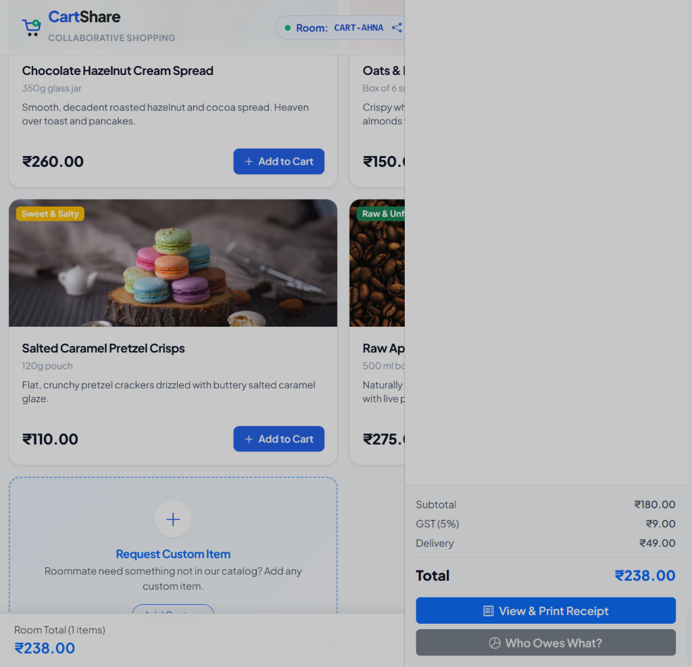

<div align="center">

  

  <br/><br/>

  [](https://developer.mozilla.org/en-US/docs/Web/HTML)
  [](https://developer.mozilla.org/en-US/docs/Web/CSS)
  [](https://getbootstrap.com/)
  [](https://developer.mozilla.org/en-US/docs/Web/JavaScript)
  [](https://vitejs.dev/)
  [](https://github.com/AahelGupta/CartShare/actions/workflows/ci.yml)
  [](https://aahelgupta.github.io/CartShare/)
  [](LICENSE)

</div>

<br/>

<div align="center">
  <a href="https://aahelgupta.github.io/CartShare/">
    
  </a>
  <p align="center"><em>Click the image above to launch the interactive live demo on GitHub Pages</em></p>
</div>

<br/>

## 🛒 Overview

**CartShare** is a browser-native collaborative shopping ecosystem designed for roommates, student dorms, travel squads, and team workspaces. It eliminates group ordering chaos by allowing multiple users to pool orders into a unified room in real time, track free delivery thresholds together, split expenses proportionally, and generate audit-ready printable receipts — all with **zero backend installation**!

---

## 🎯 The Problem & Real-World Motivation

In shared living spaces (colleges, flats, co-working desks), coordinating group delivery orders faces three big hurdles:
1. **The Communication Gap**: Orders are scattered across WhatsApp chats, leading to forgotten items, accidental duplicates, and confusion.
2. **The Delivery Threshold Trap**: Grocery and food platforms mandate minimum spend thresholds (e.g., **₹750.00**) for free shipping. Coordinating cart additions manually is clumsy.
3. **The Settlement Nightmare**: Splitting taxes (GST 5%) and delivery charges fairly based on who ordered what requires tedious manual calculations.

**CartShare** solves this with an instant, synchronized group shopping experience right in the browser.

---

## ✨ Key Features

- 🔑 **Instant Room Creation & Direct Invite Links**: Auto-generates shareable room codes (e.g., `CART-4921`) and 1-click shareable URLs (`index.html?room=CART-4921`) via the modern Clipboard API.
- ⚡ **Zero-Latency Real-Time Cross-Tab Synchronization**: Powered by the **HTML5 `BroadcastChannel` API** with automated **`storage` event listener** fallback for sub-millisecond tab-to-tab sync without a server.
- 🛒 **Collaborative Shared Cart with User Attribution**: Every item added displays an author pill (e.g., *"Added by Aahel"* or *"Added by Sarah"*), with live `+` / `-` quantity adjustments and custom unlisted item requests.
- 🚚 **Dynamic Free Delivery Progress Meter**: Interactive animated progress bar monitoring progress toward the **₹750.00 free delivery target**, unlocking celebrations and waiving the delivery fee automatically.
- 📊 **Automated "Who Owes What" Expense Splitter**: Instantly breaks down individual sub-totals, proportional 5% GST distribution, and net settlement amounts per person.
- 🖨️ **Audit-Ready Printable Receipt**: Clean `@media print` layout formatting order host, room code, itemized participant table, and individual contribution cards for physical printing or PDF export.
- 🔔 **Live Activity Feed & Interactive Toasts**: Real-time event stream logging all room actions with contextual Bootstrap toasts.

---

## 🛠️ Project Architecture & Directory Structure

```
CartShare/
├── index.html              # Core single-page application & interactive UI
├── login.html              # Room onboarding & credentials portal
├── README.md               # Detailed technical documentation
├── package.json            # Scripts and Vite tooling dependencies
├── vite.config.js          # Vite configuration
├── LICENSE                 # MIT License
├── CONTRIBUTING.md         # Contribution guidelines
├── CODE_OF_CONDUCT.md      # Contributor Covenant Code of Conduct
├── .editorconfig           # Editor consistency configuration
├── .prettierrc             # Code style formatting rules
├── .gitignore              # Git ignored files & patterns
├── .github/
│   ├── ISSUE_TEMPLATE/     # GitHub bug report and feature request templates
│   ├── PULL_REQUEST_TEMPLATE.md
│   └── workflows/
│       └── ci.yml          # GitHub Actions continuous integration check
├── css/
│   └── style.css           # Design tokens, custom animations, responsive grid & @media print
├── js/
│   ├── bundle.js           # Production standalone bundle for zero-setup execution
│   ├── app.js              # Controller, event delegation, and DOM rendering
│   ├── cart.js             # Cart engine, threshold calculator, and expense splitter
│   ├── room.js             # Room lifecycle, member presence, and Clipboard API
│   ├── storage.js          # LocalStorage persistence & BroadcastChannel sync
│   └── products.js         # Curated catalog of 100 products with realistic pricing
└── assets/
    ├── icons/
    │   └── logo.svg          # Scalable vector logo and favicon
    ├── capsule-header.svg    # Animated waving banner header
    ├── capsule-footer.svg    # Waving footer banner
    └── preview.png           # High-resolution application preview screenshot
```

---

## 🚀 How to Run Locally

### Option 1: Zero-Setup Direct Browser Launch (Fastest)
Simply **double-click `index.html`** in any modern web browser (Chrome, Edge, Firefox, Safari). It works instantly with zero setup or command line.

### Option 2: VS Code Live Server
1. Open the `CartShare` directory in VS Code.
2. Right-click `index.html` and select **"Open with Live Server"**.

### Option 3: Vite Development Server
```bash
# Clone the repository
git clone https://github.com/AahelGupta/CartShare.git

# Navigate into project directory
cd CartShare

# Install dependencies
npm install

# Start development server
npm run dev
```

---

## 🧪 Testing Real-Time Multi-Tab Synchronization

Witness the zero-backend real-time collaboration in action:
1. Open [http://localhost:3000](http://localhost:3000) (or `index.html`) in your primary browser tab.
2. Create a room as **Aahel** (👨‍💻).
3. Click the **Room Code Pill** in the top navigation bar to copy the invite link.
4. Open a **second tab** or Incognito window, paste the URL, and join as **Sarah** (👩‍🎨).
5. In Tab 2, click **"Add to Cart"** on any product.
6. Switch back to Tab 1: Notice the cart counter, the *"Added by Sarah"* badge, the delivery threshold progress bar, and the activity feed update **immediately without a page reload**!

---

## 📄 License

Distributed under the MIT License. See [LICENSE](LICENSE) for more details.

---

## 👨‍💻 Author

**Aahel Gupta**  
- 🎓 B.Tech in Computer Science & Engineering | Sister Nivedita University (SNU)
- 💼 LinkedIn: [@aahel-gupta](https://www.linkedin.com/in/aahel-gupta-5b9a5840a)
- 🐙 GitHub: [@AahelGupta](https://github.com/AahelGupta)
- 📧 Email: aahelgupta47@gmail.com

<br/>

<div align="center">
  
</div>
